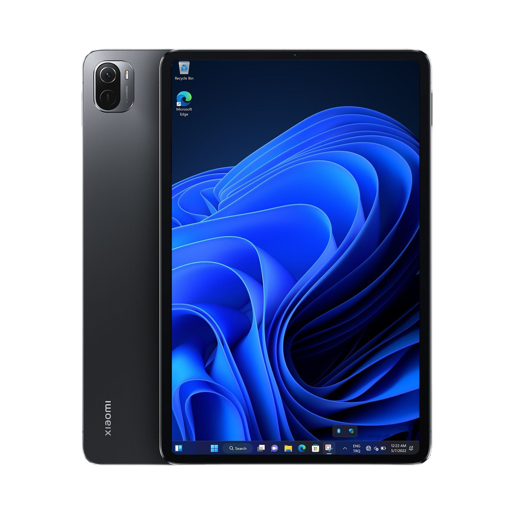

# Running Windows on the Xiaomi Pad 5

## Important notes/warnings
> While the Xiaomi Pad 5 is currently one of the most supported and stable Android devices to run Windows on, there are some rare issues that may severely affect your device. Make sure you understand these issues before installing Windows.

## 24H2 EDL issues
If you installed Windows on your NABU before 07.12.2024 and have not applied the GPT fix, please do so now using [this guide](fix-gpt-en.md) to avoid EDl issues.

## White line issues
White lines after waking from sleep have been reported with older driver/UEFI releases. The [v2611.21 release](https://github.com/remtrik-stuff/MiPad5-Windows-Releases/releases/tag/2611.21) includes a fix for display artifacts after waking from sleep.

If you still see white lines after waking Windows, **REBOOT IMMEDIATELY!!** These lines can become permanent if they stay on the screen for too long.

